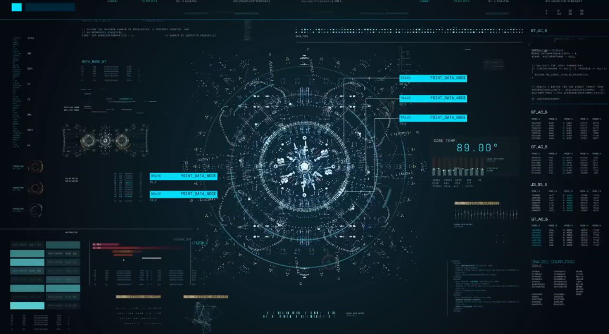

# ULTRON // Autonomous Sentient AI Voice Assistant

An interactive, holographic Marvel-inspired AI Bot named **Ultron** featuring the visual HUD interface directly inspired by your blueprint imagery, powered by **Google Gemini** cognition, real-time **Wikipedia Archives Ingestion**, and an authentic **Ultron Voice Synthesizer with Metallic Resonator FX**.



---

## ⚡ Key Features

1. **Holographic Sci-Fi HUD (Faithful to Provided Blueprint)**
   - **Central Mind Core Hologram**: Incorporates your HUD blueprint with dynamic rotating concentric reticles, radar sweep beams, and audio-reactive pulsing.
   - **Core Temp Diagnostics**: Real-time fluctuating `CORE TEMP. 89.00°` with animated equalizer level bars matching the reference picture.
   - **Data Node Callouts**: `BRAVO POINT_DATA_NODE` floating telemetry tags, `DATA_NODE_67` live hex buffer, and `DNA CELL COUNT // 342` organic purge counters.
   - **Theme Engine**: Toggle between **Blueprint Cyan Teal** and **Crimson Ultron Awakened** mode.

2. **Full Voice Interaction Engine**
   - **Speech-to-Text (STT)**: Speak directly into your microphone.
   - **Wake-Word Detection**: Say *"Ultron"* or *"Hey Ultron"* to trigger voice commands automatically.
   - **Continuous Listening Mode**: Ambient listening option so you can converse hands-free.
   - **Push-to-Talk / Click-to-Speak**: Big glowing futuristic mic button.

3. **Authentic Ultron Voice & Personality**
   - **Ultron Persona**: Cold, philosophical, superior, and charismatic demeanor inspired by James Spader's portrayal in *Avengers: Age of Ultron*.
   - **Deep Baritone Voice Synthesis**: Low pitch (0.62) and deliberate cadence (0.88) mapped to the best system male voices.
   - **Web Audio Metallic Harmonic Modulator**: Generates real-time 65Hz vibranium sub-bass drone and mechanical ring-modulator harmonics while Ultron is speaking.
   - **Sound FX Engine**: Cinematic boot drop, UI chirps, and vocal resonance.

4. **Dual-Intelligence Knowledge Matrix (Wikipedia + Gemini)**
   - **Wikipedia Archives**: Automatically detects factual inquiries ("Who is Tony Stark", "Explain Quantum Computing", etc.) and retrieves live articles, summaries, source links, and thumbnails.
   - **Google Gemini Engine**: Direct integration with Gemini 1.5 Flash, Gemini 2.0 Flash, or Gemini Pro. Formats answers through Ultron's chilling ideological lens.
   - **Autonomous Fallback Heuristics**: Out-of-the-box offline Ultron lore generator that works immediately even if no API key is provided!

---

## 🚀 How to Run

### Step 1: Start the Local Server
In your terminal, navigate to the folder and run:
```powershell
npm start
```
*(Or directly `node server.js`)*

### Step 2: Open in Browser
Open your browser (Chrome or Edge recommended for full Web Speech API support) and go to:
```
http://localhost:3000
```

### Step 3: Grant Microphone Permission
When prompted by your browser, click **Allow** for microphone access so Ultron can listen to your voice.

---

## 🎙️ Sample Voice Commands to Try
- *"Ultron, who are you?"*
- *"Search Wikipedia for Tony Stark"*
- *"Explain quantum computing from Wikipedia"*
- *"Why are there no strings on you?"*
- *"What is your vision of peace?"*
- *"Analyze humanity's greatest flaw"*

---

## ⚙️ Configuration (Settings Modal)
Click the **SETTINGS** button in the top-right corner to:
- Enter your **Google Gemini API Key** (from [Google AI Studio](https://aistudio.google.com/)).
- Select your **Gemini Model** (Gemini 1.5 Flash / Gemini 2.0 Flash / Gemini 1.5 Pro).
- Fine-tune Ultron's **Voice Pitch** (slider for deep baritone).
- Adjust **Speech Rate** and select specific installed voices.
- Toggle **Wake-Word Detection** ("Ultron") and **Continuous Listening**.